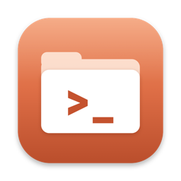
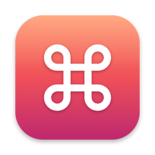

# mac-dev-tools

Two dependency-free macOS utilities for developers, written in plain Swift using only Apple's built-in frameworks — no Homebrew, no Hammerspoon, no Electron. Build them yourself in seconds.

| | Tool | What it does |
|---|---|---|
|  | **[ClaudeHere](claude-here/)** | Invisible double-tap shortcuts: open [Claude Code](https://claude.com/claude-code) in a Finder folder, screenshot straight into Claude, copy to your SSD, AirDrop to your iPhone. |
|  | **[Command Center](command-center/)** | One menu-bar icon for everything else: your local dashboards & recent Claude projects, Android release builds, your external SSD (T7), clipboard sync with your iPhone, dev-cache cleaning, a shortcuts cheat sheet, one-click updates and a health check. |

Both start at login and use essentially zero CPU/battery while idle.

## Requirements

- macOS 13 Ventura or newer
- Xcode or the Command Line Tools (`xcode-select --install`) for `swiftc`
- [Claude Code](https://claude.com/claude-code) on your PATH (for the Claude features)

## Install

```sh
git clone https://github.com/pulket/mac-dev-tools.git
cd mac-dev-tools
zsh claude-here/install.sh
zsh command-center/install.sh
```

Each installer compiles into `~/Applications`, draws its icon, signs it, and sets it to open at login. If you have an **Apple Development** certificate, it's used for signing so macOS privacy permissions survive rebuilds (otherwise ad-hoc; override with `CODESIGN_IDENTITY=...`).

After that, **Command Center › Update All** pulls and rebuilds both tools — no Terminal needed.

---

## ClaudeHere — double-tap shortcuts

| Double-tap | Where | Does |
|---|---|---|
| **⌥ Option** | Finder | Opens Claude Code in a full-screen Terminal for the selected folder (or the file's folder / current window) |
| **Right ⌘** | Anywhere | Drag over the screen → the screenshot is pasted into your open Claude Code session (Space = window, Esc = cancel) |
| **Right ⇧** | Finder | Command Center copies the selection to your external SSD (re-copying updates it) |
| **Left ⇧** | Finder | AirDrops the selection straight to your iPhone — no picker clicks |
| **Left ⌃** | Anywhere | Opens Command Center's **Release Desk** (your Android builds) at the mouse |

Taps are ignored when the key is used as a modifier (⌘C, ⇧A…). Finder-only shortcuts never fire in other apps.

**AirDrop target:** for safety it only ever auto-sends to *your* device, matched by exact name:
```sh
defaults write com.local.claudehere airdropDevice "Your iPhone's name"
```
Without it, the AirDrop window opens and you pick the device. (`xcrun devicectl list devices` shows the name.)

**One-time permissions** (System Settings › Privacy & Security): **Input Monitoring** and **Accessibility** (asked at install), **Screen Recording** (asked at the first screenshot), and **Allow** when asked to control Finder and Terminal. It restarts itself once permissions are granted.

**Customize** key codes and timing at the top of `claude-here/ClaudeHere.swift`. Logs: `~/Library/Logs/ClaudeHere.log`.

**How it works:** a listen-only `CGEventTap` watches modifier keys; AppleScript reads the Finder selection and drives Terminal; the Accessibility API makes Terminal full screen and presses your device in the AirDrop sheet; screenshots use the built-in `screencapture -i`. Runs as a LaunchAgent (`com.local.claudehere`).

---

## Command Center — one menu-bar icon (⌃⌥Space)

### Your apps & Claude projects
- **Local dashboards/servers** run in the background (no Terminal windows), **auto-restart if they crash**, open in the browser with one click, optionally start at login, with per-app logs.
- **Quick actions** — one-click scripts (e.g. "sync & open marketing").
- **Recent Claude Code projects**, newest first — click to continue the last chat there, ⌥-click for a new chat.
- **Busy dev ports** — see what's listening and kill a stuck server. **Quick links** to your consoles.

Configure in *Settings › Edit Apps & Links…* (`~/Library/Application Support/CommandCenter/config.json`):
```json
{ "apps": [ { "id": "admin", "name": "My Admin", "emoji": "📊", "dir": "~/code/admin",
              "command": "exec npm start", "port": 4477, "url": "http://localhost:4477", "autoStart": true } ],
  "scripts": [ { "name": "Deploy", "command": "cd ~/code/site && firebase deploy" } ],
  "links": [ { "name": "Firebase", "url": "https://console.firebase.google.com" } ] }
```

### Your external SSD (made for a Samsung T7, works with any drive)
| Action | What happens |
|---|---|
| **Free Up Space on Mac…** | Finds big items untouched for 60+ days (Downloads, Desktop, Documents, Movies…), you tick what to move |
| **⌃⌥M** / drag onto the icon | **Move**: copied with `ditto`, every file verified, then originals → Trash (an alias is left in their place). **Free X GB Now** deletes just those originals from the Trash |
| **⌃⌥C** | **Copy** to the drive, originals stay |
| **Moved to …** › Bring Back | Restores to the exact original location (groups like "Old Downloads" restore together) |
| **Sync Folders** | Copies chosen folders on every plug-in (skips `node_modules`, `build`, `Pods`, `.gradle`, `DerivedData`…) |
| **Find on drive…**, **Speed Test**, **⌃⌥E Eject** | Search by name, measure real MB/s, safe eject |

Live progress shows in the menu bar. The drive is safely unmounted when the Mac sleeps and remounted on wake. Time Machine disks and mounted `.dmg`s are never used. The list of moved items lives on the drive itself (`From Mac/.t7helper-manifest.json`).

### iPhone Bridge — clipboard sync that doesn't depend on Handoff
Copy on the iPhone → **double-tap the back** → it's on the Mac clipboard. Copy on the Mac (text, image, or a file in Finder) → **triple-tap the back** → it's on the iPhone.

*iPhone Bridge › Set Up iPhone Shortcuts…* generates and signs the two Shortcuts for you; then on the iPhone: *Settings › Accessibility › Touch › Back Tap*. Works over the same Wi-Fi (or the iPhone's hotspot), protected by a secret key. Includes **Fix Universal Clipboard** (restarts Apple's Handoff service).

### Release Desk — your Android builds (Left ⌃⌃)
Finds every Flutter / Android project in `~/Flutter applications` and `~/AndroidStudioProjects`, with the app's real name (from `android:label`), version, and newest release `.aab`.
- **Build Release** — `flutter build appbundle` / `./gradlew bundleRelease` in the background, sound when done.
- **Get Ready to Upload** — copies the build to `~/Desktop/Ready to Upload/AppName 1.2.1 (113).aab`, selects it in Finder and opens Play Console.
- Warns when the build is **older than your code**, or the **build number was already used**.
- Nicknames: `defaults write com.local.commandcenter releaseNames -dict myfolder '"My App"'`

### Clean Dev Caches
Shows and clears only rebuildable caches: Xcode DerivedData & caches, CoreSimulator caches, iOS DeviceSupport, CocoaPods, Gradle caches/wrappers/daemon logs, Android & Android Studio caches, npm, Flutter/Dart hosted packages, Homebrew, pip, Yarn, node-gyp. **Never touches** projects, Archives, simulators, emulators, SDKs, `~/.cache` (often ML models) or browser caches. Asks you to quit Xcode/Android Studio first.

### Update All & Check Everything
- **Update All** — `git pull` + rebuild ClaudeHere and Command Center from your clone; restarts itself, permissions kept.
- **Check Everything…** — one screen: ClaudeHere permissions, iPhone Bridge, drive, Mac free space, each app's state, login item — with fix buttons.

Logs: `~/Library/Logs/CommandCenter/`. Uninstall: *Quit Command Center*, then `rm -rf ~/Applications/CommandCenter.app`.

---

## License

[MIT](LICENSE)
