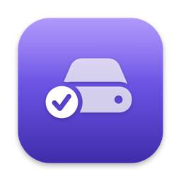

# mac-dev-tools

Three tiny, dependency-free macOS utilities for developers, written in plain Swift using only Apple's built-in frameworks. No Homebrew, no Hammerspoon, no Electron — each one is a single Swift file you build yourself in a few seconds.

| | Tool | What it does |
|---|---|---|
|  | **[ClaudeHere](claude-here/)** | Select a folder in Finder, **double-tap ⌥ Option**, and [Claude Code](https://claude.com/claude-code) opens in a full-screen Terminal in that folder. **Double-tap Right ⌘** anywhere to drag a screenshot straight into your open Claude session. |
|  | **[DevCleaner](dev-cleaner/)** | Menu-bar app that shows how much space Xcode, Gradle, Android Studio, CocoaPods, npm, Flutter, Homebrew & pip caches use — and clears them in one click. Only touches caches that are rebuilt automatically. |
|  | **[T7 Helper](t7-helper/)** | Menu-bar companion for an external SSD (made for a Samsung T7). Shows free space, moves Finder selections to the drive with **⌃⌥M** (copy → verify every file → originals to Trash), brings them back in one click, auto-syncs chosen folders on plug-in, and safely ejects. |

All three start at login, run with no Dock icon, and use essentially zero CPU/battery while idle.

## Requirements

- macOS 13 Ventura or newer
- Xcode or the Command Line Tools (`xcode-select --install`) for the `swiftc` compiler
- ClaudeHere only: [Claude Code](https://claude.com/claude-code) installed so `claude` is on your PATH

## Install

```sh
git clone https://github.com/pulket/mac-dev-tools.git
cd mac-dev-tools

zsh claude-here/install.sh   # ClaudeHere
zsh dev-cleaner/install.sh   # DevCleaner
zsh t7-helper/install.sh     # T7 Helper
```

Each script compiles the app into `~/Applications`, draws its icon, signs it, and sets it to open at login. ClaudeHere signs with your **Apple Development** certificate if you have one, so macOS privacy permissions survive rebuilds (otherwise it falls back to ad-hoc signing; override with `CODESIGN_IDENTITY=...`).

---

## ClaudeHere

**Usage:** click a folder in Finder → quickly tap **⌥ Option** twice (left or right).

- Selected a folder → opens there
- Selected a file → opens in the file's folder
- Nothing selected → opens in the folder the Finder window is showing

It only reacts while Finder is the frontmost app, and ignores ⌥ when it's used as a modifier (⌥+key).

**Screenshot → Claude:** double-tap **Right ⌘ Command** anywhere, drag over part of the screen (Space = whole window, Esc = cancel). ClaudeHere brings your most recent Claude Code tab in Terminal to the front and pastes the image (⌃V) — just type your question and press Return. If no Claude session is open, the screenshot stays on your clipboard.

**One-time permissions** (System Settings → Privacy & Security):
1. **Input Monitoring** → enable ClaudeHere (to see the double-tap)
2. **Accessibility** → enable ClaudeHere (to make Terminal full screen)
3. **Screen Recording** → enable ClaudeHere (asked the first time you take a screenshot)
4. Click **Allow** when asked to control Finder and Terminal

The app restarts itself once permissions are granted. Re-running `install.sh` produces a new signature, so you'll need to grant the permissions again.

**Customize** — edit the settings at the top of `claude-here/ClaudeHere.swift` and re-run the installer:
- `openKeys` / `openFlag` and `shotKeys` / `shotFlag` — change which keys trigger each shortcut
- `doubleTapWindow` — how fast the two taps must be

**Troubleshooting:** check `~/Library/Logs/ClaudeHere.log`.

**How it works:** a listen-only `CGEventTap` watches modifier-key changes, AppleScript reads the Finder selection and opens Terminal, and the Accessibility API sets the window to full screen. Screenshots use the built-in `screencapture -i`, go on the clipboard, and are pasted with a synthesized ⌃V. Runs as a LaunchAgent (`com.local.claudehere`).

**Uninstall:**
```sh
launchctl bootout gui/$(id -u)/com.local.claudehere
rm -rf ~/Applications/ClaudeHere.app ~/Library/LaunchAgents/com.local.claudehere.plist
```

---

## DevCleaner

Click the ✨ icon in the menu bar to see sizes, then clean one item or **Clean Everything**. It always asks for confirmation, and asks you to quit Xcode / Android Studio first if they're open.

**What it cleans** (contents only — all rebuilt automatically when needed):

| Group | Items |
|---|---|
| iOS / Xcode | DerivedData, Xcode caches, CoreSimulator caches, iOS DeviceSupport, CocoaPods cache |
| Android | `~/.gradle/caches`, Gradle wrapper dists, Gradle daemon logs, `~/.android/cache`, Android Studio caches |
| Other | npm cache, Flutter/Dart hosted packages (`~/.pub-cache/hosted`), Homebrew downloads, pip, Yarn, node-gyp |

**What it never touches:** your projects, Xcode Archives, simulators, Android emulators (AVDs), SDKs, `~/.cache` (often holds ML models), browser caches, globally activated Dart tools.

Sizes are measured only when you open the menu — nothing runs in the background. Toggle **Open at Login** from its menu.

**Uninstall:** choose *Quit DevCleaner* from its menu, then `rm -rf ~/Applications/DevCleaner.app`.

---

## T7 Helper

A menu-bar icon shows your drive's free space whenever it's plugged in.

| Action | What happens |
|---|---|
| Select items in Finder → **⌃⌥M** | **Move** to the drive: copied with `ditto`, every file count/byte checked, then originals go to the Trash. Stored under `From Mac/` mirroring their path in your home folder. |
| Select items in Finder → **⌃⌥C** | **Copy** to the drive (`Copied from Mac/`), originals stay |
| Menu → **Moved to …** → item → **Bring Back** | Restores it to its exact original location (verified), then removes it from the drive |
| Menu → **Sync Folders** → **Add Folder…** | Copies the folder to `Synced Folders/` every time the drive is plugged in (skips `node_modules`, `build`, `Pods`, `.gradle`, `DerivedData`, …) |
| **⌃⌥E** or menu → **Eject** | Safe eject, with a clear message if something is still using the drive |

**Safety:** always confirms first; if verification fails nothing is deleted; refuses to move main home folders (Desktop, Documents, Library…) or app data (`~/Library`, dotfolders); ⌃⌥M/⌃⌥C only act while Finder is frontmost. Moved originals go to the **Trash** — empty it to actually free space.

**Which drive:** your Samsung T7 is picked automatically (by model name). Any other drive is only used if you choose it under *Use a Different Drive*. Time Machine disks and mounted `.dmg` installers are never offered.

The list of moved items is stored on the drive itself (`From Mac/.t7helper-manifest.json`), so it follows the drive. No polling — the app only wakes on mount/unmount events or when you use it.

**Uninstall:** *Quit T7 Helper* from its menu, then `rm -rf ~/Applications/T7Helper.app`.

---

## License

[MIT](LICENSE)
