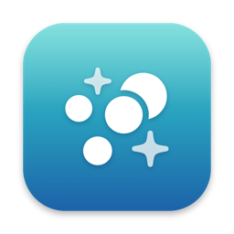

# mac-dev-tools

Two tiny, dependency-free macOS utilities for developers, written in plain Swift using only Apple's built-in frameworks. No Homebrew, no Hammerspoon, no Electron — each one is a single Swift file you build yourself in a few seconds.

| | Tool | What it does |
|---|---|---|
|  | **[ClaudeHere](claude-here/)** | Select a folder in Finder, **double-tap ⌥ Option**, and [Claude Code](https://claude.com/claude-code) opens in a full-screen Terminal in that folder. |
|  | **[DevCleaner](dev-cleaner/)** | Menu-bar app that shows how much space Xcode, Gradle, Android Studio, CocoaPods, npm, Flutter, Homebrew & pip caches use — and clears them in one click. Only touches caches that are rebuilt automatically. |

Both start at login, run with no Dock icon, and use essentially zero CPU/battery while idle.

## Requirements

- macOS 13 Ventura or newer
- Xcode or the Command Line Tools (`xcode-select --install`) for the `swiftc` compiler
- ClaudeHere only: [Claude Code](https://claude.com/claude-code) installed so `claude` is on your PATH

## Install

```sh
git clone https://github.com/pulket/mac-dev-tools.git
cd mac-dev-tools

zsh claude-here/install.sh   # ClaudeHere
zsh dev-cleaner/install.sh   # DevCleaner
```

Each script compiles the app into `~/Applications`, draws its icon, ad-hoc signs it, and sets it to open at login.

---

## ClaudeHere

**Usage:** click a folder in Finder → quickly tap **⌥ Option** twice (left or right).

- Selected a folder → opens there
- Selected a file → opens in the file's folder
- Nothing selected → opens in the folder the Finder window is showing

It only reacts while Finder is the frontmost app, and ignores ⌥ when it's used as a modifier (⌥+key).

**One-time permissions** (System Settings → Privacy & Security):
1. **Input Monitoring** → enable ClaudeHere (to see the double-tap)
2. **Accessibility** → enable ClaudeHere (to make Terminal full screen)
3. Click **Allow** when asked to control Finder and Terminal

The app restarts itself once permissions are granted. Re-running `install.sh` produces a new signature, so you'll need to grant the permissions again.

**Customize** — edit the settings at the top of `claude-here/ClaudeHere.swift` and re-run the installer:
- `triggerKeyCodes` / `triggerFlag` — use ⌘ or ⌃ instead of ⌥
- `doubleTapWindow` — how fast the two taps must be

**Troubleshooting:** check `~/Library/Logs/ClaudeHere.log`.

**How it works:** a listen-only `CGEventTap` watches modifier-key changes, AppleScript reads the Finder selection and opens Terminal, and the Accessibility API sets the window to full screen. Runs as a LaunchAgent (`com.local.claudehere`).

**Uninstall:**
```sh
launchctl bootout gui/$(id -u)/com.local.claudehere
rm -rf ~/Applications/ClaudeHere.app ~/Library/LaunchAgents/com.local.claudehere.plist
```

---

## DevCleaner

Click the ✨ icon in the menu bar to see sizes, then clean one item or **Clean Everything**. It always asks for confirmation, and asks you to quit Xcode / Android Studio first if they're open.

**What it cleans** (contents only — all rebuilt automatically when needed):

| Group | Items |
|---|---|
| iOS / Xcode | DerivedData, Xcode caches, CoreSimulator caches, iOS DeviceSupport, CocoaPods cache |
| Android | `~/.gradle/caches`, Gradle wrapper dists, Gradle daemon logs, `~/.android/cache`, Android Studio caches |
| Other | npm cache, Flutter/Dart hosted packages (`~/.pub-cache/hosted`), Homebrew downloads, pip, Yarn, node-gyp |

**What it never touches:** your projects, Xcode Archives, simulators, Android emulators (AVDs), SDKs, `~/.cache` (often holds ML models), browser caches, globally activated Dart tools.

Sizes are measured only when you open the menu — nothing runs in the background. Toggle **Open at Login** from its menu.

**Uninstall:** choose *Quit DevCleaner* from its menu, then `rm -rf ~/Applications/DevCleaner.app`.

---

## License

[MIT](LICENSE)
